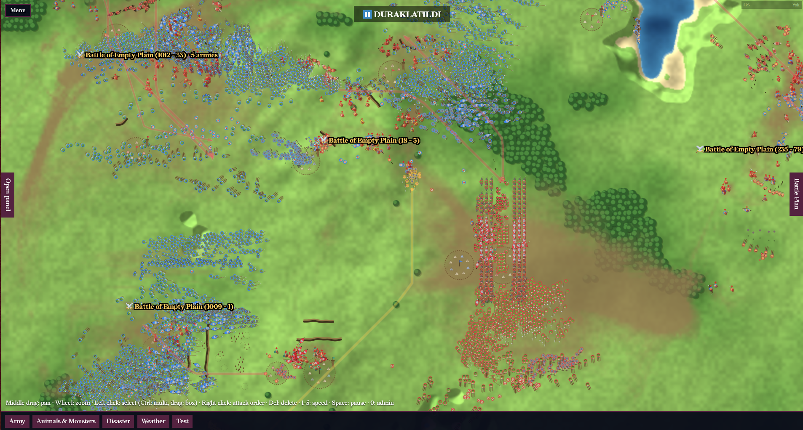
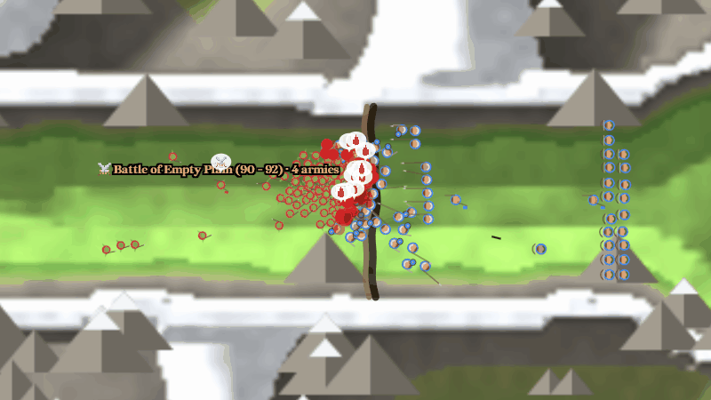
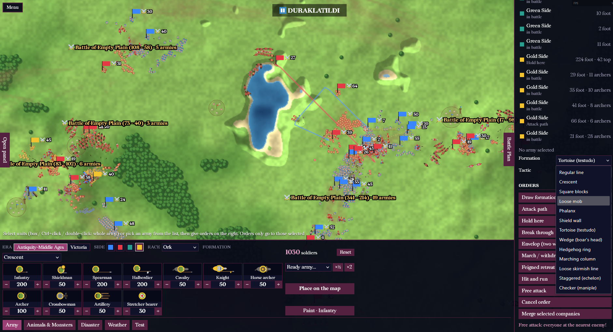
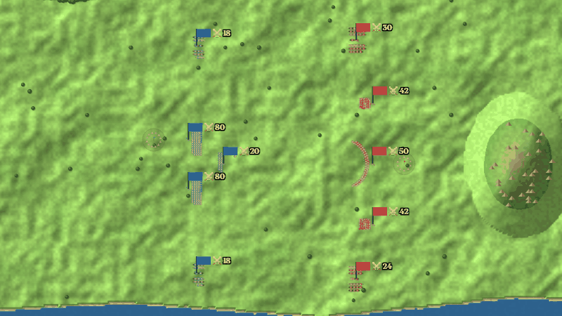
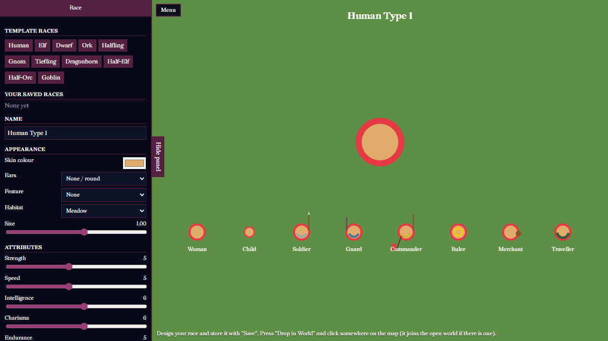
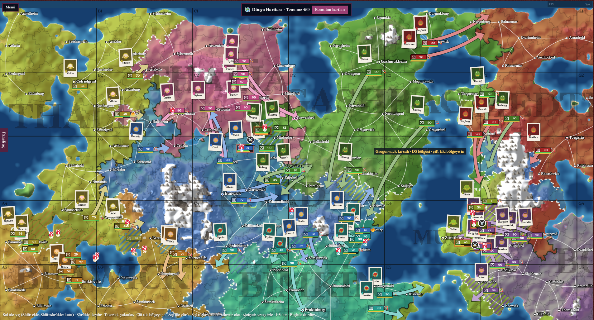
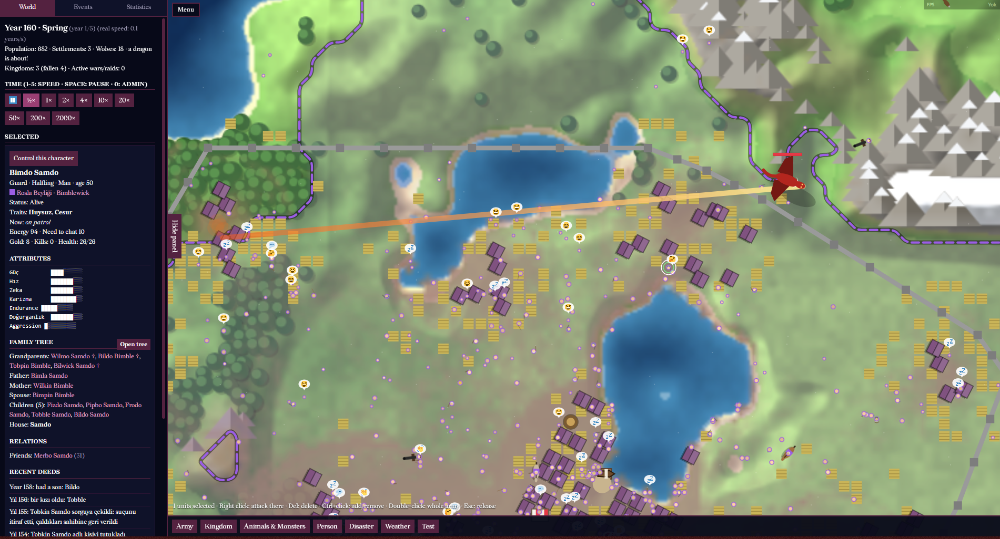
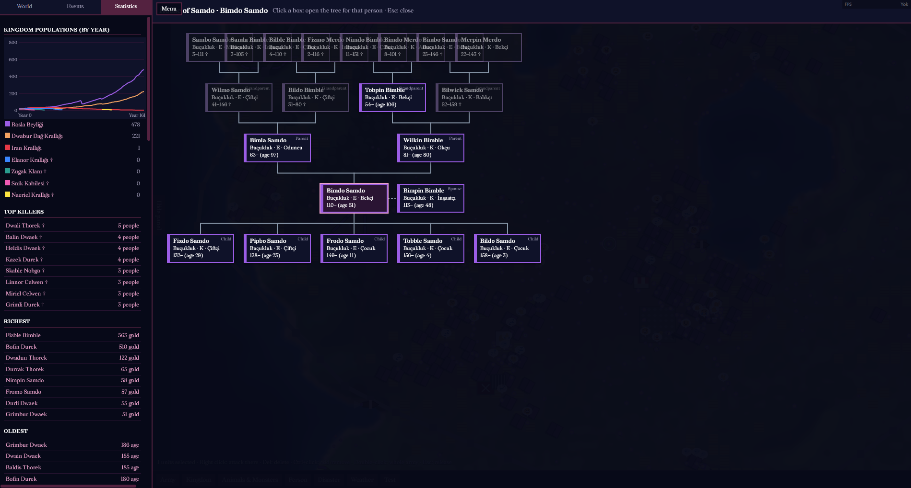
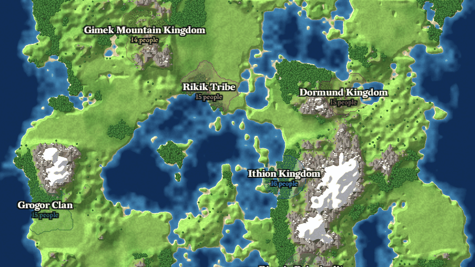

  

An optimized battle simulator with massive armies. Commanders, tactics, soldiers, military bases, traps, trenches and much more.

  

Build your army from dozens of units, give any order to any army and watch who wins. Or jump onto the field and fight as a single soldier. On a battlefield where tactics and positioning matter, the intelligence and decision-making of commanders and the stats of soldiers can change the outcome of a battle.

  

  

  

Create your own race and customize its size, color, ears, horns and more.

  

Create your world, then watch civilizations develop or guide them yourself.

  

  

  

  

Inspired by games like Totally Accurate Battle Simulator, WorldBox, Hearts of Iron IV and Dwarf Fortress.

The graphics are simple because of the scale: this is what makes giant battles with tens of thousands of soldiers possible.

## Play

- **In your browser:** [play it here](https://akgazii.github.io/SancakTaburu/), nothing to install.
- **Offline:** [download the ZIP](https://github.com/akgazii/SancakTaburu/archive/refs/heads/main.zip), extract it and open `index.html`.

## Controls

### General
- Space: pause / resume
- 1: 0.5x speed
- 2: 1x speed
- 3: 2x speed
- 4: 4x speed
- 5: 10x speed
- 0: admin panel
- Delete: delete selected units
- Esc: cancel the selection and active tool, or close the menu if it is open

### Camera
- Mouse wheel: zoom in / out
- Middle mouse + drag: pan the map

### Selection and orders
- Left click: select a person, village or kingdom
- Left mouse + drag: box select
- Ctrl/Shift + click: add to / remove from selection
- Ctrl/Shift + drag: add the box to the selection
- Double-click: select the soldier's whole army
- Right click: order selected armies to attack there

### Battle Plan
- Draw formation: draw a line or shape and the soldiers line up along it
- Attack path: draw a path, the army marches along it and attacks at the end
- Hold here: press on the spot, then drag toward the direction to face
- Break through: draw a path through the enemy line
- Envelop (two wings): click an enemy and the army circles around from both sides
- March / withdraw: draw a path, the army moves without fighting and holds position
- Feigned retreat: click the spot to flee to
- Hit and run: applied instantly
- Free attack: applied instantly

### Character control
- Select a person and press "Control this character" in the panel
- WASD / arrow keys: walk
- F (hold): attack
- Esc: release control

### Placing units
- Click on land: place the army
- Left mouse + drag: paint units with the brush
- + / - buttons: change the count, holding speeds it up
- Mouse wheel on a unit card: change the count by 1
- Shift + button or wheel: change the count by 10
- Esc: stop placing

### World and Big World
- Left click: select
- Left mouse + drag: pan the map
- Shift/Ctrl + click: add to / remove from selection
- Shift/Ctrl + drag: box select
- Right click: march order
- Right mouse + drag: draw an offensive arrow
- Double-click: enter a region
- Click a battle icon: watch the battle
- Esc: clear the selection

### Level Mode
- Left click / drag: place the unit in the blue area
- Right click / drag: take a soldier back for a refund
- Numpad *: edit mode, lets you place enemies too

## License

Copyright 2026 Akgazi. The game's code and original assets are licensed under the [Apache License 2.0](LICENSE). If you use or redistribute this project, you must keep the [NOTICE](NOTICE) file.

Third-party content stays under its own licenses, listed in [LICENSE.txt](LICENSE.txt).
